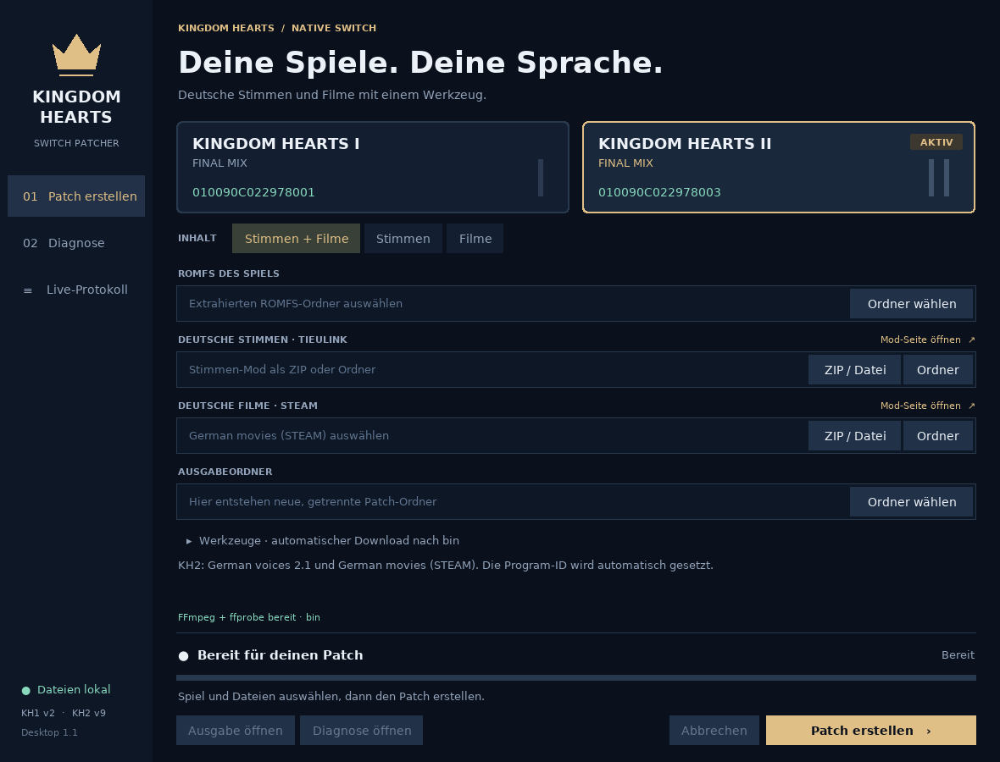

# Kingdom Hearts Switch Patcher

**Deutsche Stimmen für Kingdom Hearts I Final Mix und deutsche Stimmen + Steam-Filme für Kingdom Hearts II Final Mix – in einer gemeinsamen Desktop-Oberfläche.**

Der Patcher übernimmt die Dateien der unten verlinkten PC-Mods in die Archive
deines extrahierten Switch-ROMFS. Das Ergebnis ist ein `atmosphere`-Ordner
für die Switch. Die Originaldateien bleiben erhalten.



## Unterstützte Spiele

| Spiel | Inhalt | Feste Program-ID |
|---|---|---|
| Kingdom Hearts I Final Mix | Deutsche Stimmen | `010090C022978001` |
| Kingdom Hearts II Final Mix | Deutsche Stimmen, deutsche Steam-Filme oder beides zusammen | `010090C022978003` |

Die Oberfläche setzt die passende ID automatisch. Bei KH1 bleiben Intro und
Abspann entsprechend dem Originalmod auf Englisch.

## Voraussetzungen

- Windows 10/11 mit 64 Bit.
- [Python 3.10 oder neuer](https://www.python.org/downloads/windows/) mit Tkinter. Beim offiziellen Windows-Installer ist Tkinter normalerweise enthalten.
- Der extrahierte ROMFS des jeweiligen Switch-Spiels aus deiner eigenen Kopie.
- Die passenden Deutsch-Mods aus dem nächsten Abschnitt.
- Ein beschreibbarer Programmordner, ausreichend freier Speicher für die neue Mod-Ausgabe und Internet für den ersten Werkzeug-Download.
- Eine Switch-Einrichtung, die Atmosphère-LayeredFS-Mods laden kann.

Zusätzliche Python-Pakete oder eine Installation mit `pip` sind nicht nötig.
Spielarchive, Sprachaufnahmen und Filme sind im Patcher-Paket nicht enthalten.

## Deutsch-Patches herunterladen

### Kingdom Hearts I Final Mix

Der deutsche Stimmen-Mod stammt von **Rikux3**:

- [Projektseite: kh1fm-undub-ger-pc](https://github.com/Rikux3/kh1fm-undub-ger-pc)
- [Passenden, vom Patcher geprüften Quellenstand als ZIP herunterladen](https://github.com/Rikux3/kh1fm-undub-ger-pc/archive/e17e035f10fe6d61954051fb21371c0452aefdb4.zip)

Wähle dieses Quellen-ZIP in der Oberfläche unter **Deutsche Stimmen** aus.
Ein entpackter Quellenordner mit erhaltener Verzeichnisstruktur ist ebenfalls
möglich. Der KH1-Patcher prüft die enthaltenen Audiodateien gegen sein Manifest.

### Kingdom Hearts II Final Mix

Beide Downloads stammen von **TieuLink** und liegen auf derselben Nexus-Modseite:

- [German voices – Mod-Beschreibung](https://www.nexusmods.com/kingdomhearts2finalmix/mods/42)
- [Dateien und Downloads öffnen](https://www.nexusmods.com/kingdomhearts2finalmix/mods/42?tab=files)

| Download im Reiter „Files“ | Version | Auswahl in der Oberfläche |
|---|---|---|
| **German voices** | **2.1** mit Steam-Unterstützung | Deutsche Stimmen |
| **German movies (STEAM)** | **1.0** | Deutsche Filme · Steam |

Für **Stimmen + Filme** werden beide Downloads benötigt. Wähle die ZIP-Dateien
direkt aus oder verwende ihre vollständig entpackten Ordner. Für den hier
beschriebenen Ablauf wird das Filmpaket **German movies (STEAM)** verwendet.
Für den Download bei Nexus Mods ist eine Anmeldung erforderlich.

## Starten und automatisch FFmpeg einrichten

1. Das komplette Patcher-Paket in einen beschreibbaren Ordner entpacken.
2. **START.pyw** doppelklicken. Alternativ **START.cmd** verwenden.
3. Beim Start prüft die Oberfläche `bin/ffmpeg.exe` und `bin/ffprobe.exe`.
4. Fehlt ein Programm oder ist das vorhandene Paar unbrauchbar, lädt der Patcher
   automatisch das Windows-Paket **FFmpeg 9.0.2 Essentials von Gyan.dev** herunter.
   Der Download umfasst ungefähr **110 MB**.
5. Nach Prüfung der SHA-256-Prüfsumme werden beide Programme entpackt, ihre
   Ausführbarkeit und die benötigten Codecs geprüft und im gemeinsamen
   **bin-Ordner neben START.pyw** installiert.

Die GUI zeigt dabei Fortschritt und Downloadgröße an. Sobald **FFmpeg + ffprobe
bereit · bin** erscheint, kann KH2 gepatcht werden. Funktionierende Programme
im `bin`-Ordner werden beim nächsten Start ohne erneuten Download weiterverwendet.

Bei einem Downloadfehler gibt es **Erneut herunterladen**. Die genaue Meldung
steht im **Live-Protokoll**. Unter **Werkzeuge** kann alternativ ein eigener
Ordner mit beiden Programmen gewählt werden. Dieser sollte auch die zugehörigen
DLLs enthalten, falls ein dynamischer FFmpeg-Build verwendet wird. Benötigt
werden der `libvorbis`-Decoder sowie die Encoder `libvorbis` und `libx264`.
KH1 benötigt FFmpeg nicht und bleibt auch bei einem Downloadfehler nutzbar.

Downloadquelle: [Gyan.dev – FFmpeg Builds](https://www.gyan.dev/ffmpeg/builds/),
verlinkt auf der [offiziellen FFmpeg-Downloadseite](https://ffmpeg.org/download.html).
Die Programme, Lizenzhinweise und Downloadinformationen landen ausschließlich
im gemeinsamen `bin`-Ordner. Das Archiv und temporäre Installationsdateien
werden nach dem Vorgang entfernt.

## Einen Patch erstellen

1. **Kingdom Hearts I** oder **Kingdom Hearts II** auswählen.
2. Für KH2 **Stimmen + Filme**, **Stimmen** oder **Filme** festlegen.
3. Den **ROMFS des ausgewählten Spiels** auswählen. Verwende den Stand, mit dem
   du anschließend spielen wirst. Der Ordner muss die benötigten `.hed`- und
   `.pkg`-Archivpaare enthalten.
4. Den Stimmen-Mod und gegebenenfalls das Steam-Filmpaket auswählen.
5. Einen **Ausgabeordner außerhalb von ROMFS und Modordnern** angeben.
6. **Patch erstellen** anklicken und den erfolgreichen Abschluss abwarten.
7. Den fertigen `atmosphere`-Ordner aus dem neu angelegten Auftrag auf die
   SD-Karte kopieren. Die Moddateien liegen je nach Spiel unter:

   - KH1: `atmosphere/contents/010090C022978001/romfs/`
   - KH2: `atmosphere/contents/010090C022978003/romfs/`

Jeder Lauf erhält einen eigenen Ordner wie `KH-Patch-KH2-…`. Für KH2 erzeugt
**Stimmen + Filme** einen gemeinsamen Modordner. Fortschritt, verstrichene Zeit
und Meldungen erscheinen in der Oberfläche. Die gewählten Pfade werden pro
Spiel gespeichert. Laufende Aufträge lassen sich mit **Abbrechen** beenden.

## Diagnose und Fehler

Unter **Diagnose** kann ein Prüfauftrag gestartet werden. Für eine reine
KH1-Diagnose wird kein Stimmen-Mod benötigt.

Im jeweiligen Auftragsordner liegen die Berichte und **KH-Diagnose.zip**.
Die Schaltflächen **Ausgabe öffnen** und **Diagnose öffnen** führen direkt
dorthin. **Protokoll speichern** exportiert die Meldungen aus dem Live-Protokoll.

Die Diagnose enthält Protokolle, Metadaten und gegebenenfalls kleine
Audio-/Archivproben; vollständige Spielarchive und Filme werden nicht eingepackt.
Bei einem Fehler oder Abbruch wird keine fertige Mod-Ausgabe im Hauptordner
freigegeben. Details zur Ursache bleiben im Auftragsordner erhalten.

Wenn FFmpeg nicht installiert werden kann, zuerst Internetverbindung und
Schreibrechte im entpackten Patcher-Ordner prüfen und den Download wiederholen.
Bei einer Prüfsummenabweichung wird das heruntergeladene Paket verworfen.

## Entwicklung und Prüfstand

Die Oberfläche und der automatische Download verwenden ausschließlich die
Python-Standardbibliothek. Die bisherigen Archiv- und Medien-Engines liegen
unverändert unter `engines/kh1` und `engines/kh2` und laufen in eigenen Prozessen.
`tool_setup.py` enthält die festgelegte FFmpeg-Version, Downloadadresse und
SHA-256-Prüfsumme.

Tests im Projektordner starten:

```powershell
py -3 -m unittest discover -s tests -v
py -3 -m unittest discover -s engines/kh1/tests -v
py -3 -m unittest discover -s engines/kh2/tests -v
```

GUI-Tests benötigen eine grafische Umgebung. Der Download und das Entpacken
des echten Windows-Archivs wurden auf Linux geprüft. Die Ausführung der
heruntergeladenen Windows-Programme und ein vollständiger Test der gemeinsamen
GUI auf Windows und Switch stehen noch aus. Der genaue Prüfstand ist in
[validation.json](validation.json) dokumentiert.

## Credits und Lizenzen

- **Rikux3**: KH1-Mod und deutsche Stimmen.
- **TieuLink**: KH2-Patch und deutsche Stimmen der Zwischensequenzen.
- **RubyX_Coded**: KH2-Kampfstimmen von Sora, Donald, Goofy und Roxas.
- **Fotia**: KH2-Boss-Kampfstimmen.
- **FFmpeg-Projekt und Gyan.dev**: Medienwerkzeuge und Windows-Builds.
- Weitere Quellen und Hinweise stehen in [NOTICE](NOTICE) und den jeweiligen Engine-Ordnern.

Der Patcher-Code steht unter **Apache-2.0**, siehe [LICENSE](LICENSE).
Der automatisch heruntergeladene FFmpeg-Build steht separat unter **GPLv3 oder
neuer**; seine Lizenz und README werden im `bin`-Ordner abgelegt. Die Rechte
an Spielen, Filmen und externen Moddateien verbleiben bei ihren jeweiligen
Rechteinhabern. Lade die Deutsch-Mods über die verlinkten Originalseiten herunter.
